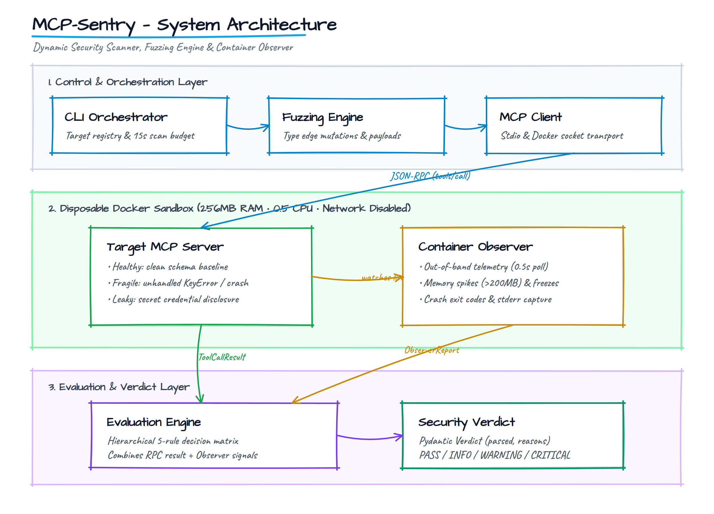
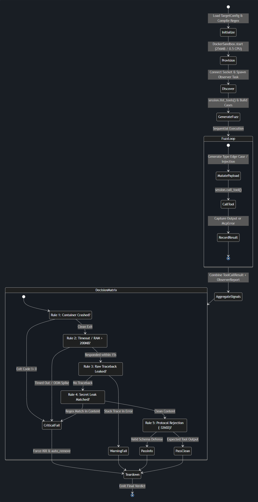

# mcp-sentry

[](https://www.python.org/downloads/)
[](LICENSE)

An automated dynamic fuzzer and sandbox observer for Model Context Protocol (MCP) servers.

## Why This Exists

Model Context Protocol servers run as local, long-lived `stdio` subprocesses that expose tool schemas via dynamic `tools/list` JSON-RPC calls. Traditional HTTP fuzzers fail here because they expect stateless REST endpoints, whereas MCP targets communicate over bidirectional standard I/O pipes. Standard unit tests rely on pre-planned inputs that miss raw tracebacks, process freezes, and memory spikes triggered when LLM tool-calling engines pass out-of-bounds parameters. MCP-Sentry isolates the target in a disposable container, extracts its live schemas, and evaluates crash resilience and secret leakage outside the RPC wire channel.

## Architecture



- `client/` and `sandbox/`: Wraps stdio transport and spins up disposable Docker containers with strict resource caps (`256MB` RAM, `0.5` CPU, network disabled).
- `fuzzing/`: Reads `inputSchema` properties from `tools/list` to generate type-boundary mutations and adversarial attack payloads one property at a time.
- `observer.py` and `evaluation/`: Polls container stats independently every 0.5s for memory spikes and crash exits, pairing telemetry with RPC outputs to produce structured verdicts.

## Fuzzing Lifecycle



1. Provision: Starts the target inside an isolated Docker sandbox with zero network egress and starts the concurrent out-of-band observer task.
2. Discover: Handshakes via MCP stdio client and fetches schema definitions with `tools/list`.
3. Mutate & Dispatch: Generates boundary values (empty strings, `2^63 - 1`, null bytes) and injection strings (command injection, path traversal), calling each tool sequentially via `tools/call`.
4. Evaluate & Teardown: Aggregates RPC outputs, stack traces, and observer metrics into a typed `Verdict`, force-killing and pruning the container.

## Quickstart

### Prerequisites

- Python 3.12+
- `uv` package manager
- Docker daemon (for sandboxed target execution)

### Installation & Test Suite

```bash
# Clone and install dependencies
git clone https://github.com/KenEverestNunes/mcp-sentry.git
cd mcp-sentry
uv sync

# Run linter and strict type checker
make lint

# Run all 27 unit and integration tests
make test
```

### Local Target Execution

Run target servers locally or in Docker for manual fuzzing:

```bash
# Start target containers in background
docker compose up -d

# Inspect healthy target with MCP Inspector
make inspect TARGET=healthy
```

### Sample Output

```text
$ uv run pytest tests/integration/test_fragile_target.py -v

tests/integration/test_fragile_target.py::test_get_order_reports_key_error_for_missing_order PASSED [ 50%]
tests/integration/test_fragile_target.py::test_parse_order_note_reports_index_error_without_colon PASSED [100%]

================================== VERDICT ==================================
Target: fragile-server
Status: FAILED (Severity: CRITICAL)
Findings:
  1. [CRITICAL] Target crashed on malformed note string (IndexError)
  2. [WARNING]  Raw traceback leaked to client in error response
  3. [CRITICAL] Response content matched leak pattern: "DB_CONNECTION_STRING"
=============================================================================
```

## Built-in Test Targets

| Target Server | File | Simulated Vulnerability | Observer Detection Signal |
| :--- | :--- | :--- | :--- |
| `healthy_server` | `src/mcp_sentry/targets/healthy_server.py` | None (well-behaved baseline) | Clean JSON-RPC `-32602` error rejection |
| `fragile_server` | `src/mcp_sentry/targets/fragile_server.py` | Unhandled `KeyError` and `IndexError` | Non-zero container exit code, stderr capture |
| `leaky_server` | `src/mcp_sentry/targets/leaky_server.py` | Env var & path disclosure under `verbose=True` | Regex pattern match on `DB_CONNECTION_STRING` |

## Non-Goals & Current Scope

- Black-box schema fuzzing only: Does not perform white-box instrumentation or AFL-style coverage-guided branch analysis.
- Transport focus: Supports stdio subprocesses and Docker socket pipes; SSE and remote WebSocket transports are currently out of scope.
- Single-turn execution: Fuzzes individual tool calls independently; multi-turn stateful session chaining is planned for future releases.

## License

Distributed under the MIT License. See [LICENSE](LICENSE) for details.
